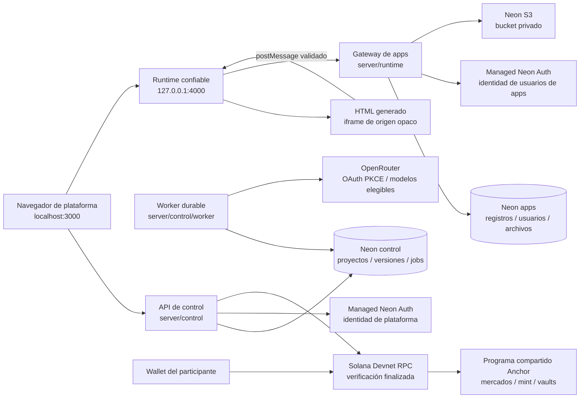

# Arquitectura — revisión Neon / Devnet

Revisión: 13 de octubre de 2026. Describe el código de esta rama y las decisiones actuales. Los dos proyectos Neon, Auth y el bucket privado están aprovisionados; los recorridos de los servicios externos siguen pendientes de aceptación. Las propuestas originales están enlazadas en [DRIVE_INVENTORY.md](DRIVE_INVENTORY.md). La separación del gateway de apps resuelve la divergencia entre Mermaid y SVG encontrada en el ZIP original.

## Componentes y fronteras



| Componente | Responsabilidad | Información que no recibe |
| --- | --- | --- |
| React `src/` | Sesión de plataforma, editor, versiones, discovery, feedback y firma de wallet | Claves OpenRouter/Neon/S3 o claves técnicas de Solana |
| Control API | Validación, propietario, CSRF, OAuth, jobs, publicación y verificación financiera | HTML ejecutado como código del servidor |
| Worker | Lease, intento, envío, validación y recibos de uso | Fondos de aportes convertidos en crédito IA |
| Runtime confiable | Sesión propia de app, bridge y acceso al gateway | Cookie de plataforma o clave del proveedor |
| HTML generado | Interfaz y llamadas al SDK según manifiesto | Cookies de sesión, SQL, acceso directo a S3 o wallet |
| Programa Devnet | Supply, autoridades, curva y movimiento de activos de prueba | Proyectos privados, prompts y costes IA |

La plataforma y runtime requieren **hostnames distintos**, no sólo puertos distintos. Desarrollo usa `http://localhost:3000` y `http://127.0.0.1:4000`. En producción se requieren HTTPS, orígenes explícitos y claves persistentes. No se habilita Mainnet.

## Dos proyectos Neon cloud

El alcance actual utiliza **`promptfun-control`** y **`promptfun-apps`**, dedicados y separados, en AWS `us-east-1`. El primero aloja identidad de plataforma y plano de control; el segundo, identidad de usuarios finales y datos de apps. Ningún proyecto ajeno debe reutilizarse, pausarse o modificarse para este setup. El adapter Supabase permanece por compatibilidad; sus rutas históricas no determinan el backend elegido.

Neon anunció Backend GA el 17 de septiembre de 2026. Managed Auth se basa en Better Auth y el almacenamiento ofrece una API compatible con S3. Estas capacidades deben configurarse en los proyectos elegidos; su existencia en el producto no demuestra que esta cuenta tenga recursos conectados. [Anuncio GA](https://neon.com/blog/neon-backend-is-ga), [Auth](https://neon.com/docs/auth/overview), [Storage](https://neon.com/docs/storage/overview).

La documentación de planes consultada el 13 de octubre indica Free: hasta 100 proyectos, 60.000 MAU de Auth, 5 GB de objetos y 1 GB de Postgres por proyecto, con límites agregados de cuenta y uso. Las cuotas actuales, región, facturación y disponibilidad deben comprobarse en la cuenta antes del piloto; no se han reservado ni garantizado. [Planes Neon, revisión del 6 de octubre](https://github.com/neondatabase/website/blob/main/content/docs/introduction/plans.md).

Las migraciones SQL siguen en `supabase/control/migrations` y `supabase/apps/migrations` por el layout histórico. Se aplican a las conexiones `CONTROL_DATABASE_URL` y `APPS_DATABASE_URL`; el runner registra el hash y rechaza modificar una migración ya aplicada.

## Identidad y secretos

La autenticación email/contraseña Neon pasa por el BFF. Éste valida la sesión upstream y el correo confirmado, guarda la cookie de proveedor cifrada y entrega una sesión propia HTTP-only. No copia la cookie de proveedor al navegador ni fabrica bearer tokens. El flujo de confirmación admite el código OTP recibido por correo y después pide login normal. Los sujetos opacos se traducen a identificadores internos estables según proveedor, plano e issuer; no se fusionan por email. La identidad de app está separada de la plataforma y restringida mediante membresía de app.

La decisión humana del 13 de octubre añade acceso opcional de plataforma mediante Phantom/Solflare. El BFF emite un challenge con nonce y expiración y verifica su firma Ed25519; no consulta RPC, mueve SOL ni usa autenticación wallet nativa de Neon. Login y vinculación son modos distintos: vincular requiere la sesión y CSRF actuales, no fusiona cuentas por email ni autoriza finanzas de proyectos. La credencial de wallet se guarda en el plano control, puede iniciar una cuenta con `email: null` y no puede quitarse cuando es el único método de acceso. Auth de usuarios de apps continúa en Managed Neon Auth por correo. La nueva ruta y su UI no acreditan todavía pruebas con extensiones reales.

Backup/restore conserva la dirección pública y estado `active`/`revoked` de `wallet_credentials`; excluye sesiones y challenges. Entrar después de restaurar exige una nueva firma sobre nonce y origen actuales. Las credenciales secretas OpenRouter permanecen revocadas/redactadas. La migración control 005 y sus RLS/grants se aplicaron al plano principal; la prueba de acceso BFF/SQL en Neon QA sigue pendiente de resultado y no equivale a una extensión personal verificada.

OpenRouter utiliza PKCE, state de un solo uso y credenciales cifradas del lado del servidor. Revocar la conexión impide nuevas inferencias sin borrar proyectos. El catálogo sólo acepta modelos elegibles gratuitos; cuota agotada, revocación, tiempo de espera y uso desconocido permanecen como estados reales. OAuth no concede acceso a una wallet. [OpenRouter OAuth](https://openrouter.ai/docs/guides/overview/auth/oauth), [límites del proveedor](https://openrouter.ai/docs/api-reference/limits).

`ENCRYPTION_KEY` y `RUNTIME_SIGNING_KEY` deben mantenerse en el archivo ignorado `.env` o un gestor de secretos. Sin claves persistentes, el modo diagnóstico de desarrollo puede arrancar, pero los grants/tokens no sobreviven de forma fiable al reinicio. Claves DB, S3, registrar, program keypair y upgrade keypair no se incluyen en el frontend, Git ni los artefactos públicos.

## Persistencia y generación

Actualización del 15 de octubre: `project_drafts` almacena prompt exacto, modelo, versión base del mismo proyecto y revisión independiente de las versiones inmutables. `GET /api/projects/:id/draft` devuelve revisión 0 cuando no existe; `PUT` requiere los tres campos y la revisión leída, verifica propietario/Origin/CSRF y serializa por proyecto. Una revisión desactualizada devuelve `409 DRAFT_CONFLICT`; un reenvío idéntico de la revisión inmediatamente anterior reconoce el guardado ya confirmado sin otra escritura. La migración control 006 aplica RLS y revoca acceso de roles de navegador. Ninguna respuesta pública incorpora el borrador.

El editor guarda después de 800 ms sin cambios y serializa las escrituras, conservando las ediciones realizadas durante una petición. Antes de generar, cambiar proyecto, salir de la vista, cerrar sesión o redirigir a OpenRouter espera la confirmación del servidor. Un fallo bloquea esa salida y conserva el texto local; cerrar o recargar con cambios pendientes activa el aviso del navegador. El borrador vive en el servidor, sin copiar prompts a almacenamiento del navegador. El identificador del proyecto activo se conserva en la URL y sólo se selecciona entre los proyectos autorizados.

Backup/restore incluye borradores y revisiones. Los respaldos anteriores a 005/006 pueden omitir únicamente las tablas nuevas conocidas cuando su journal no declara esas migraciones; los hashes originales se verifican antes de normalizar tablas vacías en memoria. Un destino con esas migraciones adicionales debe coincidir con sus SHA locales; cualquier otro drift sigue rechazado. No se fabrican journals ni se restauran sesiones o claves del proveedor.

El control almacena usuarios, sesiones, proyectos, versiones, conexiones, jobs, intentos, recibos, feedback, intenciones y verificación de mercado. Una versión conserva HTML, manifiesto, prompt privado, hash, versión padre y changelog. `published_version_id` selecciona el artefacto público; una candidata nueva no lo reemplaza. Crear proyecto y publicar guardan recibos durables de idempotencia en la misma transacción que el cambio. El historial de publicaciones es inmutable y sólo expone metadata pública, hash y changelog; no prompts o borradores.

El worker obtiene jobs con bloqueo y lease. Distingue preparar, enviar y recibir una inferencia; reenvío HTTP idempotente no crea un segundo job. Si un lease vence después del envío, el job pasa a `uncertain` y no vuelve a enviar automáticamente. Los recibos de consumo son independientes del resultado de generación. Una respuesta válida puede terminar sin cambios; un consumo desconocido no se sustituye por cero. La conciliación consulta el recibo del proveedor cuando dispone de un request ID y conserva evidencia de intentos.

Un job `uncertain` bloquea otra generación del mismo actor, proyecto, versión base y prompt con `409 GENERATION_REVIEW_REQUIRED`, aunque cambien el modelo o la clave de idempotencia. Reutilizar la clave original devuelve el job existente. La UI detiene el polling, indica «Requiere revisión» y permite consultar manualmente `GET /jobs/:id`; esa consulta no reenvía inferencia ni resuelve la ejecución. Conciliar un recibo de consumo no demuestra que aquella ejecución terminó ni desbloquea una generación equivalente. Sólo queued/running/validating mantienen actividad automática; resultado y consumo se presentan por separado.

La versión base y su fuente/manifiesto llegan al modelo. El resultado se valida contra un manifiesto acotado: colecciones `tasks`, `notes`, `items`, `attachments`, auth, archivos y el conector permitido. El modelo devuelve un artefacto; nunca ejecuta migraciones o servidores arbitrarios.

## Runtime y datos de la app

El outer frame confiable puede operar su sesión del runtime. El iframe interior usa sandbox sin `allow-same-origin`, CSP y SDK inyectado; su origen es opaco. El bridge acepta mensajes sólo del iframe esperado, con canal, método y estructura permitidos, tamaño máximo y concurrencia acotada. El SDK no contiene secretos.

Las generaciones que usan registros, archivos o conectores declaran `auth: true`. El manifiesto admite `connectors: []` o `connectors: ['github.repository']`. `records.update` reemplaza el objeto `data` completo; la app debe combinar los campos actuales con los cambios que desea guardar. El SDK de archivos expone `files.upload(File)`, `files.list()`, `files.download(id)` y `files.delete(id)`; el borrado devuelve `{ok: true}` a través del mismo gateway con autenticación y CSRF.

Cada operación identifica versión, manifiesto, app y usuario autorizado. El gateway realiza CRUD por app/usuario; cambiar app_id, collection o ID no concede acceso a otro tenant. Las tablas de datos no conceden acceso directo amplio a una sesión managed-auth. La UI de login/signup vive en el documento confiable, no en el HTML generado.

Los adjuntos tienen un máximo de 5 MiB, metadata y SHA-256. El gateway limita por app a 1.000 registros y a 25 MiB o 1.000 objetos; estos límites propios no equivalen a las cuotas de Neon. Los objetos se almacenan en bucket privado y se entregan a través del gateway autorizado. No hay URL pública de objetos por defecto. Una publicación de frontend no publica registros ni adjuntos. La persistencia y restauración de Neon S3 requieren pruebas reales; los respaldos no se consideran aceptados por disponer de un script. Restaurar datos no restaura `neon_auth`, sesiones o secretos ni garantiza login en un proyecto con issuer diferente.

## Contratos principales

La API de plataforma está bajo `/api`; mutaciones con sesión exigen `Origin` y `X-CSRF-Token`. Creación de proyectos, publicación, jobs e importación incluyen idempotencia. Los contratos compartidos están en `shared/contracts.ts`.

| Familia | Operaciones |
| --- | --- |
| Sesión | `GET /session`, `POST /auth/login\|signup\|verify-email\|logout`; Google no configurado en Neon |
| Acceso wallet | `POST /auth/wallet/challenge\|verify`, `GET\|DELETE /auth/wallet`; login opcional o vínculo explícito, sin transacción |
| Creador | `GET\|POST /projects`, detalle, actualización, versiones, jobs, importación privada, publicación y preview-token |
| Borrador privado | `GET\|PUT /projects/:id/draft`: `{prompt,model,base_version_id,revision}`; respuesta `{draft}` con revisión/fecha; conflicto explícito `409 DRAFT_CONFLICT` |
| Proveedor | Estado/conexión OpenRouter, redirección PKCE, revocación y modelos elegibles |
| Público | Listado/detalle publicado, preview URL, feedback por versión y moderación del propietario |
| Mercado | Wallet challenge/verify, registro explícito, quote, transacción preparada, submit y conciliación |
| Aportes | Intención con importe/destino/referencia, firma, submit y consulta de estado |
| Runtime | `/apps/:appId/api`: sesión propia, CRUD de colecciones, archivos y conector acotado |

La vista pública omite prompts y HTML privado de versiones candidatas. El artefacto publicado puede abrirse en runtime; esa accesibilidad es parte de publicar frontend, no una promesa de secreto sobre su código.

## Mercado Devnet

Supply: 1.000.000.000 tokens, precisión 6; curva 800.000.000 y tramo bloqueado 200.000.000. El programa compartido crea mint SPL clásico, revoca mint authority y no establece freeze authority. Registro requiere las firmas del creador y registrar autorizado. Los estados `prepared` y `active` se mantienen separados.

En unidades mínimas, con `Vₜ = 1.073.000.000 × 10⁶` y `Vₛ = 30 × 10⁹`:

```text
C(s) = ceil(Vₛ × Vₜ / (Vₜ − s)) − Vₛ
Compra(q) = C(s + q) − C(s)
Venta(q)  = C(s) − C(s − q)
0 ≤ s ≤ 800.000.000 × 10⁶
```

Las cotizaciones duran 90 segundos y fijan el importe exacto: cambios de curva requieren cotizar nuevamente. El cap no inicia graduación; permite vender y recomprar. Comisión de protocolo 0; rent y costes de transacción siguen aplicando. Los aportes directos tienen una intención independiente y no mueven la curva ni pagan IA.

El servidor construye transacciones sin firmar por el participante. La wallet conserva firmas parciales, firma y envía a Devnet; el servidor verifica transacción finalizada, programa, mint, vaults, destinos e importes antes de acreditar. Una firma única impide acreditar dos veces. La firma conocida permite recuperar una operación después de una respuesta RPC incierta.

CI Linux utiliza Anchor 1.2.1, build SBF y harness LiteSVM; produce `promptfun_market.so`, IDL y `artifact.json` con hash e ID. El run del ID actual C2AEAUWXez38SBM7Hz7SmfZ8dd9WdefEvkXsKUPFNyvG pasó 3 SBF y 3 matemáticas; el artefacto/hash se registran en validación. El despliegue coteja claves técnicas externas, valida Devnet y verifica bytecode/autoridades; los scripts preparan sin enviar salvo `--submit`. CI aprobado no equivale a despliegue o transacciones finalizadas.

## Límites actuales

Neon S3 privado y backup/restore SQL+objetos se comprobaron en QA aislado; el artefacto actual pasó CI. Falta validar cuentas reales, CRUD/adjuntos desde navegador, OpenRouter, recuperación de identidad, operación/alertas y despliegue/transacciones Devnet. No hay G1/G2/G3 cerrado. El adaptador anterior no autoriza modificar proyectos Supabase existentes; los recursos dedicados mantienen ese aislamiento. Consulte [VALIDATION.md](VALIDATION.md) antes de anunciar disponibilidad.

